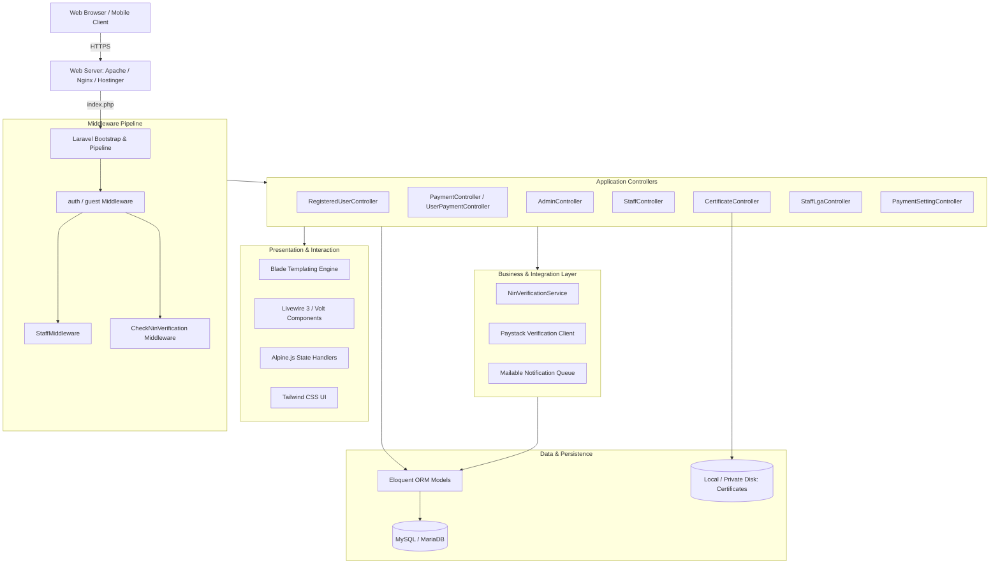
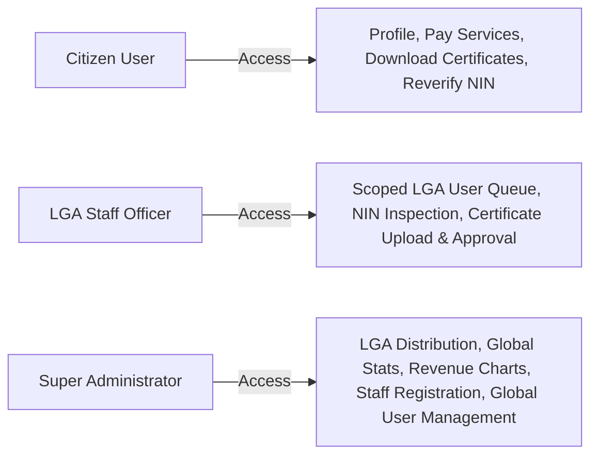
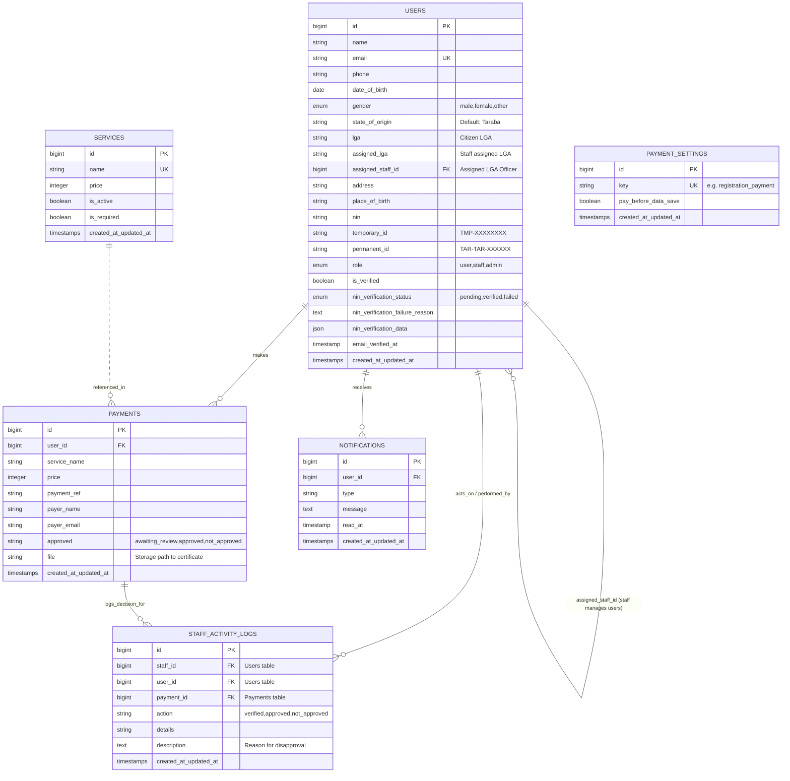
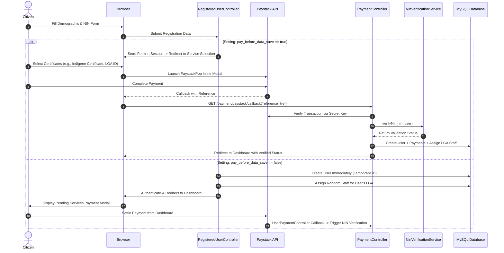
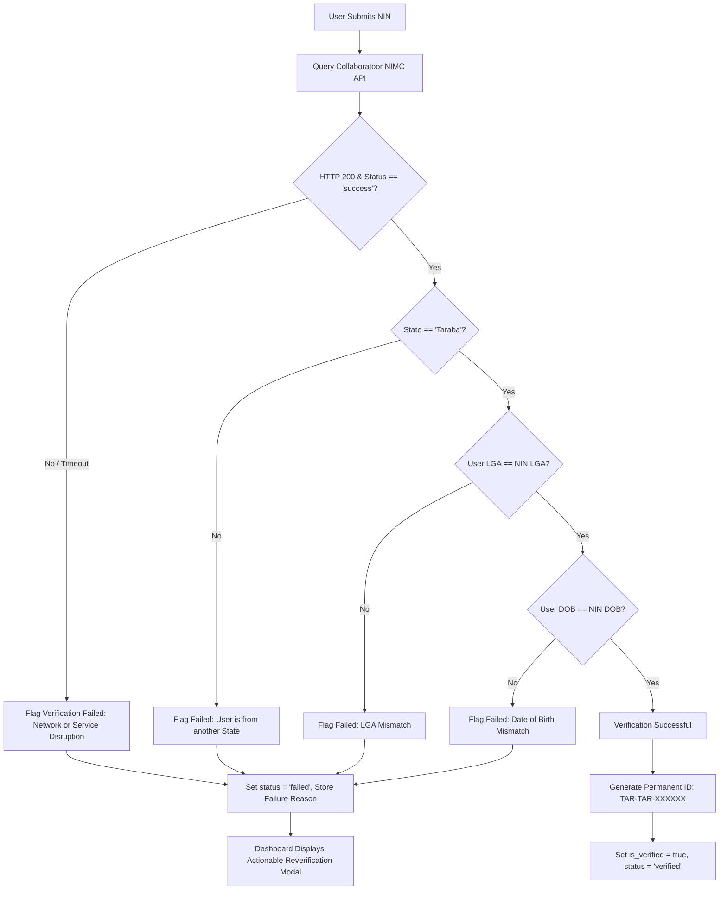
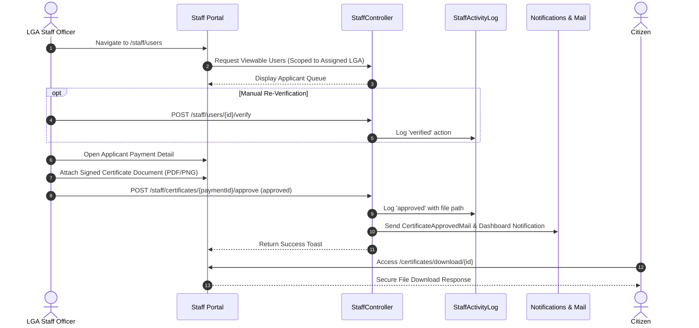

# Taraba State Indigene Verification & Certification Platform
## System Architecture & Technical Documentation

[](https://laravel.com)
[](https://php.net)
[](https://tailwindcss.com)
[](https://livewire.laravel.com)
[](#)

---

## 1. Executive Summary

The **Taraba State Indigene Verification & Certification Platform** is an enterprise-grade digital identity, indigene verification, and certification portal engineered for the Government of Taraba State, Nigeria. 

The platform digitizes and automates the verification of citizen indigene claims across the **16 Local Government Areas (LGAs)** of Taraba State. It features direct integration with the **National Identity Management Commission (NIMC)** National Identification Number (NIN) verification API, automated geographical and demographic validation, secure online payment processing via **Paystack**, role-based staff review workflows, certificate generation, and an automated LGA load-balancing assignment engine.

```
                      +---------------------------------------+
                      |       Citizen Registration Portal     |
                      +---------------------------------------+
                                          |
                      +-------------------+-------------------+
                      |                                       |
                      v                                       v
          +-----------------------+               +-----------------------+
          |   NIMC Verification   |               |   Paystack Gateway    |
          |  (NIN / LGA / DOB)    |               |  (Card / USSD / Bank) |
          +-----------------------+               +-----------------------+
                      |                                       |
                      +-------------------+-------------------+
                                          |
                                          v
                      +---------------------------------------+
                      |   LGA Staff Verification Workspace   |
                      |    (16 Taraba LGAs Distributed)      |
                      +---------------------------------------+
                                          |
                                          v
                      +---------------------------------------+
                      |   Approved Certificate Issuance &    |
                      |   Secure Multi-channel Delivery       |
                      +---------------------------------------+
```

---

## 2. High-Level Architecture

The platform follows a modern, decoupled **Model-View-Controller (MVC)** architectural pattern within the Laravel 12 framework, enhanced with a dedicated **Service Layer** for external integrations, asynchronous queue workers for notification handling, and fine-grained middleware pipelines.



---

## 3. Technology Stack & Key Dependencies

| Layer | Technology | Version | Purpose |
| :--- | :--- | :--- | :--- |
| **Backend Core** | PHP | `^8.2` | Runtime environment |
| **Framework** | Laravel | `^12.0` | MVC architecture, routing, ORM, queues |
| **Reactive UI** | Livewire & Volt | `^3.4` / `^1.7` | Dynamic reactive components without SPA overhead |
| **Client State** | Alpine.js | `^3.4` | Modal dialogs, dropdowns, client checkout bindings |
| **Styling** | Tailwind CSS | `^3.1` / `@tailwindcss/vite` | Modern responsive utility-first UI styling |
| **Asset Bundler** | Vite | `^6.2` | High-performance client-side asset compilation |
| **Payment Gateway**| Paystack API | Standard REST + Inline JS | Secure transaction settlement (NGN) |
| **Identity API** | Collaboratoor NIMC API | JSON REST Endpoint | Real-time biometric/demographic NIN verification |
| **Database** | MySQL / SQLite | 8.0+ / 3.x | Relational entity and session/queue persistence |
| **Mailing** | Laravel Mailable / SMTP | TLS Port 587 | Transactional citizen and staff notifications |

---

## 4. User Personas & Access Control Matrix

The platform implements a **Three-Tier Role-Based Access Control (RBAC)** architecture:



### Detailed Permissions Matrix

| Feature / Action | Citizen (`user`) | LGA Officer (`staff`) | Administrator (`admin`) |
| :--- | :---: | :---: | :---: |
| Self-Registration & Profile Management | ✅ | ❌ | ❌ |
| Pay for Certificates & LGA ID Card | ✅ | ❌ | ❌ |
| Run NIN Verification / Re-verification | ✅ (Self) | ✅ (Assigned) | ✅ (All) |
| Download Approved Certificate | ✅ (Self) | ❌ | ✅ (All) |
| View Assigned LGA Applicant Queue | ❌ | ✅ (Assigned LGA) | ✅ (Global) |
| Approve / Reject Certificate Application | ❌ | ✅ (Assigned LGA) | ✅ (Global) |
| Upload Signed Certificate File | ❌ | ✅ (Assigned LGA) | ✅ (Global) |
| View Staff Activity Audit Logs | ❌ | ❌ | ✅ |
| Assign / Reassign Staff to LGAs | ❌ | ❌ | ✅ |
| Execute LGA Load-Balancing Reassignment | ❌ | ❌ | ✅ |
| Configure Payment Settings (Pay-First vs Pay-Later)| ❌ | ❌ | ✅ |
| Manage Services & Pricing Catalog | ❌ | ❌ | ✅ |
| View Revenue Analytics & Registration Charts | ❌ | ❌ | ✅ |

---

## 5. Domain Models & Relational Schema



---

## 6. Core Application Workflows

### 6.1. Registration & Payment Pipeline

The platform supports a dual registration workflow dictated dynamically by the `payment_settings.pay_before_data_save` database flag.



### 6.2. NIN Identity & Indigene Verification Engine

Automated verification occurs through `App\Services\NinVerificationService`. The service enforces three strict validation rules against the NIMC biometric record:

1. **State of Origin Match**: `nin_data.state_of_origin` must strictly match `"taraba"`.
2. **LGA of Origin Match**: The LGA selected during registration must strictly match `nin_data.lga_of_origin`.
3. **Date of Birth Match**: The citizen's submitted Date of Birth (`YYYY-MM-DD`) must match the date of birth on NIMC records.



### 6.3. Staff Review & Certificate Issuance Workflow



### 6.4. LGA Load Balancing Subsystem

Taraba State comprises 16 distinct Local Government Areas:

| # | Local Government Area | # | Local Government Area |
|---|-----------------------|---|-----------------------|
| 1 | Ardo Kola             | 9 | Kurmi                 |
| 2 | Bali                  | 10| Lau                   |
| 3 | Donga                 | 11| Sardauna              |
| 4 | Gashaka               | 12| Takum                 |
| 5 | Gassol                | 13| Ussa                  |
| 6 | Ibi                   | 14| Wukari                |
| 7 | Jalingo               | 15| Yorro                 |
| 8 | Karim Lamido          | 16| Zing                  |

When a citizen registers:
- `User::assignUserToRandomStaff($user)` inspects the citizen's LGA.
- It identifies active staff members with `assigned_lga == $user->lga`.
- It assigns a staff member randomly to balance application volume.
- **Admin Command / Scheduled Routine**: `php artisan users:reassign-staff {--force}` can be triggered manually or via cron to re-distribute workloads dynamically when new staff members are onboarded.

---

## 7. Storage & File Management Architecture

Uploaded certificates and generated assets are managed through Laravel's Filesystem abstraction:

```
storage/
├── app/
│   ├── private/
│   │   └── certificates/    # Private signed certificates (Access restricted)
│   └── public/              # Public asset storage
├── framework/
│   ├── cache/               # Application & data cache
│   ├── sessions/            # File-based session fallback
│   └── views/               # Compiled Blade views
└── logs/
    └── laravel.log          # System application logs
```

### Certificate Access Control
Certificates are protected from unauthorized direct URL access. Downloading requires:
1. Active session authentication (`auth` middleware).
2. Explicit ownership verification (`$payment->user_id === Auth::id()` or administrative override).
3. Delivery through `CertificateController::downloadCertificate($id)` using streaming file responses.

---

## 8. Deployment & Infrastructure Architecture

The platform includes comprehensive deployment automation tailored for standard Linux distributions and **Hostinger Web Hosting (Cloud / VPS / Shared)**:

```
                                +-----------------------------+
                                |      Internet / HTTPS       |
                                +-----------------------------+
                                               |
                                               v
                                +-----------------------------+
                                |      Hostinger / Apache     |
                                |     (.htaccess Protection)  |
                                +-----------------------------+
                                               |
                     +-------------------------+-------------------------+
                     |                                                   |
                     v                                                   v
      +-----------------------------+                     +-----------------------------+
      |       public/index.php      |                     |      Cron Job Automation    |
      |   - Gzip Compression        |                     |   - Queue Worker (Email)    |
      |   - Security Headers        |                     |   - Laravel Task Scheduler  |
      |   - Sensitive Folder Shield |                     |   - Load Balance Reassign   |
      +-----------------------------+                     +-----------------------------+
                     |                                                   |
                     +-------------------------+-------------------------+
                                               |
                                               v
                                +-----------------------------+
                                |      Laravel Application    |
                                |    (PHP 8.2+ / Artisan)     |
                                +-----------------------------+
                                               |
                                               v
                                +-----------------------------+
                                |      MySQL Database &       |
                                |     Private Storage Disk    |
                                +-----------------------------+
```

### 8.1. Web Server Hardening (`.htaccess`)
The root `.htaccess` enforces enterprise-grade web server policies:
- **Directory Access Shield**: Direct HTTP requests to `storage/`, `bootstrap/cache/`, `vendor/`, `database/`, `tests/`, `config/`, `app/`, `routes/`, and `resources/` are blocked with `403 Forbidden`.
- **Sensitive File Shield**: `.env`, `composer.json`, `package.json`, and `*.log` files are completely inaccessible.
- **Security Headers**:
  - `X-Frame-Options: SAMEORIGIN` (Clickjacking mitigation)
  - `X-XSS-Protection: 1; mode=block`
  - `X-Content-Type-Options: nosniff`
  - `Referrer-Policy: strict-origin-when-cross-origin`
  - Granular `Content-Security-Policy (CSP)`
- **Performance Optimization**: `mod_deflate` Gzip compression and `mod_expires` caching for static assets.

### 8.2. Cron Jobs & Daemon Infrastructure

For complete operational functionality, the following cron commands should be scheduled in the server control panel:

```bash
# 1. Essential Queue Worker (Dispatches background emails & notifications)
* * * * * /usr/bin/php /path/to/project/artisan queue:work --stop-when-empty

# 2. Laravel Task Scheduler (Executes maintenance tasks)
* * * * * /usr/bin/php /path/to/project/artisan schedule:run

# 3. Weekly LGA Staff Load-Balancing Reassignment
0 2 * * 0 /usr/bin/php /path/to/project/artisan users:reassign-staff --force
```

---

## 9. Directory Structure & Key Files Reference

```
indigene_verification/
├── app/
│   ├── Console/Commands/
│   │   └── ReassignUsersToStaff.php       # CLI command for load-balancing
│   ├── Http/
│   │   ├── Controllers/
│   │   │   ├── AdminController.php         # Admin analytics, payments & staff activity
│   │   │   ├── CertificateController.php   # Secure certificate download handler
│   │   │   ├── PaymentController.php       # Registration Paystack verification callback
│   │   │   ├── PaymentSettingController.php# Pay-before vs pay-after toggles
│   │   │   ├── ServiceController.php       # Service catalogue CRUD operations
│   │   │   ├── StaffController.php         # Staff dashboard, queue & review workflows
│   │   │   ├── StaffLgaController.php      # Staff LGA assignment manager
│   │   │   └── UserPaymentController.php   # Authenticated user Paystack checkout & reverify
│   │   └── Middleware/
│   │       ├── CheckNinVerification.php    # Intercepts failed NIN status on protected routes
│   │       └── StaffMiddleware.php         # Restricts staff workspace to authorized roles
│   ├── Mail/                              # Transactional email classes (Mailable)
│   ├── Models/
│   │   ├── Notification.php                # Citizen notifications
│   │   ├── Payment.php                     # Payment transactions
│   │   ├── PaymentSetting.php              # Dynamic checkout policy settings
│   │   ├── Service.php                     # Certificate catalog & fees
│   │   ├── StaffActivityLog.php            # Audit trail for staff actions
│   │   └── User.php                        # User identity, roles & LGA scopes
│   └── Services/
│       └── NinVerificationService.php      # NIMC API client & validation engine
├── config/                                # Application, DB, Mail & Service configuration
├── database/
│   ├── migrations/                        # Structured database schema history
│   └── seeders/                           # Initial payment settings & default seeders
├── public/
│   ├── .htaccess                          # Apache web server rules & security filters
│   ├── index.php                          # Single entry point
│   └── json/nigeria-states-lgas.json      # Nigerian geographical boundary dataset
├── resources/
│   ├── views/
│   │   ├── admin/                         # Admin dashboards, revenue charts, staff logs
│   │   ├── auth/                          # Login, registration, service selection, checkout
│   │   ├── certificates/                  # Citizen certificate download portal
│   │   ├── staff/                         # LGA officer workspace & applicant review
│   │   └── dashboard.blade.php            # Primary citizen and admin dashboard
│   ├── css/app.css                        # Tailwind CSS source
│   └── js/app.js                          # Alpine.js & client scripts
├── routes/
│   ├── web.php                            # Main HTTP route definitions
│   └── auth.php                           # Authentication & password reset routes
└── storage/                               # Logs, private certificates, and session storage
```

---

## 10. Environment & Configuration Reference

Create a `.env` file in the project root with the following configuration keys:

```dotenv
APP_NAME="Taraba State Indigene Verification"
APP_ENV=production
APP_KEY=base64:YOUR_APP_KEY_HERE
APP_DEBUG=false
APP_URL=https://indigene.tarabastate.gov.ng

# Database Persistence
DB_CONNECTION=mysql
DB_HOST=127.0.0.1
DB_PORT=3306
DB_DATABASE=taraba_indigene_db
DB_USERNAME=taraba_user
DB_PASSWORD=YOUR_STRONG_PASSWORD

# Drivers
SESSION_DRIVER=database
QUEUE_CONNECTION=database
FILESYSTEM_DISK=local

# Paystack Gateway Credentials
PAYSTACK_PUBLIC_KEY=your_paystack_public_key
PAYSTACK_SECRET_KEY=your_paystack_secret_key
PAYSTACK_PAYMENT_URL=https://api.paystack.co

# Mail Delivery (SMTP)
MAIL_MAILER=smtp
MAIL_HOST=mail.tarabastate.gov.ng
MAIL_PORT=587
MAIL_USERNAME=noreply@tarabastate.gov.ng
MAIL_PASSWORD=YOUR_MAIL_PASSWORD
MAIL_ENCRYPTION=tls
MAIL_FROM_ADDRESS="noreply@tarabastate.gov.ng"
MAIL_FROM_NAME="Taraba State Indigene Verification Portal"
```

---

## 11. Security & Operational Hardening Architecture

The platform incorporates multi-tiered security safeguards:

1. **Authentication & Password Hygiene**:
   - Passwords hashed using bcrypt (`BCRYPT_ROUNDS=12`).
   - Rate limiting enforced on authentication and verification routes (`throttle:6,1`).
   - Session fixation protection and database-backed session storage.

2. **Transaction Integrity**:
   - All Paystack transaction callbacks require server-to-server HTTP verification using the secret key before account status or payments are updated.
   - Reference deduplication prevents replay attacks.

3. **Auditability**:
   - Every staff action (verification approval, rejection, certificate upload) is immutably recorded in `staff_activity_logs` with staff ID, target citizen ID, timestamp, and detailed explanatory notes.

4. **Security Audit & Continuous Hardening**:
   - A dedicated internal security assessment report is maintained by the engineering team covering credential management, environment segregation, and periodic dependency scanning.

---

## 12. Local Development & Setup Guide

### Prerequisites
- PHP `>= 8.2` with `pdo_mysql`, `mbstring`, `openssl`, `curl`, `fileinfo` extensions
- Composer `>= 2.5`
- Node.js `>= 18.x` & npm
- MySQL / MariaDB Server

### Installation Steps

1. **Clone the repository:**
   ```bash
   git clone https://github.com/Havosoft/indegene_verification.git
   cd indegene_verification/indigen_verification/indigene_verification
   ```

2. **Install backend dependencies:**
   ```bash
   composer install
   ```

3. **Install and compile frontend assets:**
   ```bash
   npm install
   npm run build
   ```

4. **Set up environment:**
   ```bash
   cp .env.example .env
   php artisan key:generate
   ```

5. **Execute database migrations and seeders:**
   ```bash
   php artisan migrate --seed
   ```

6. **Serve the application:**
   ```bash
   php artisan serve
   ```

---

*Document maintained by the Engineering Team. For questions or internal inquiries, contact the administrative office.*
